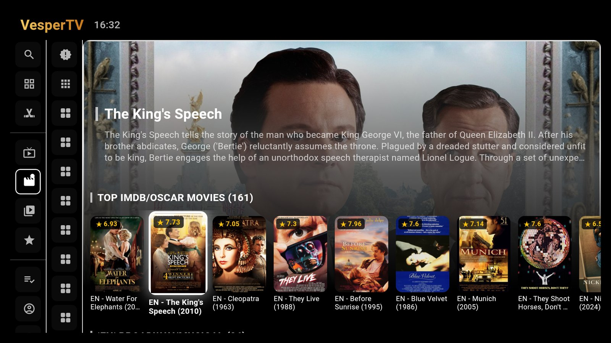
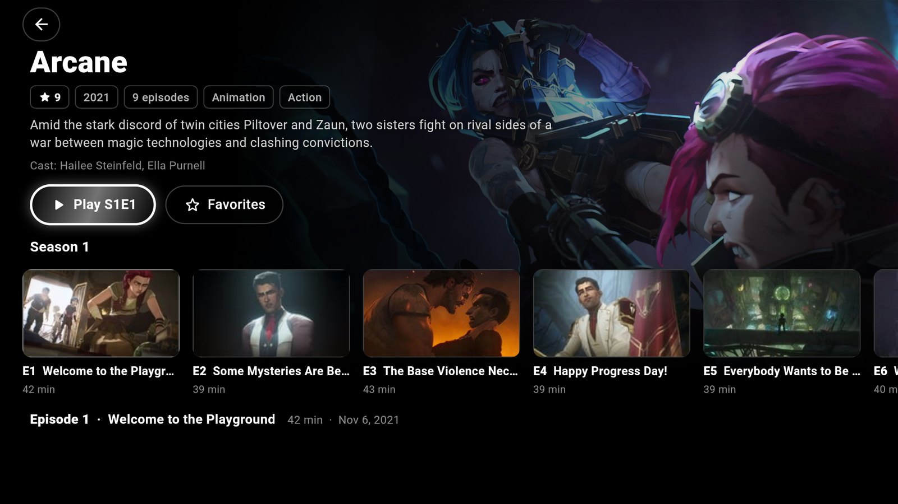
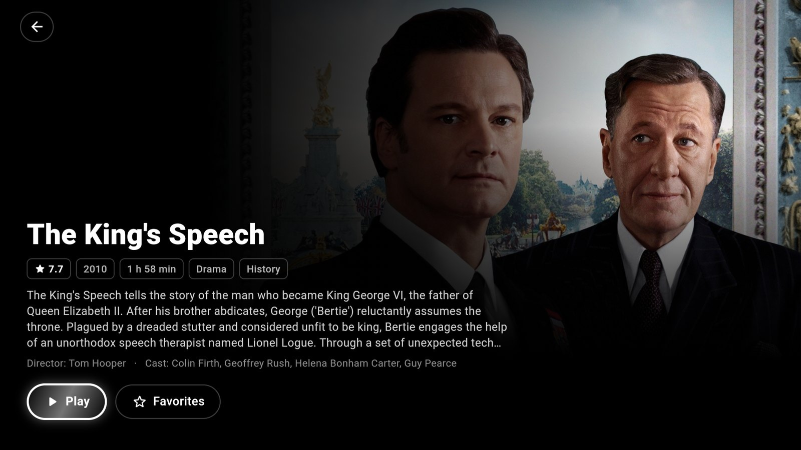
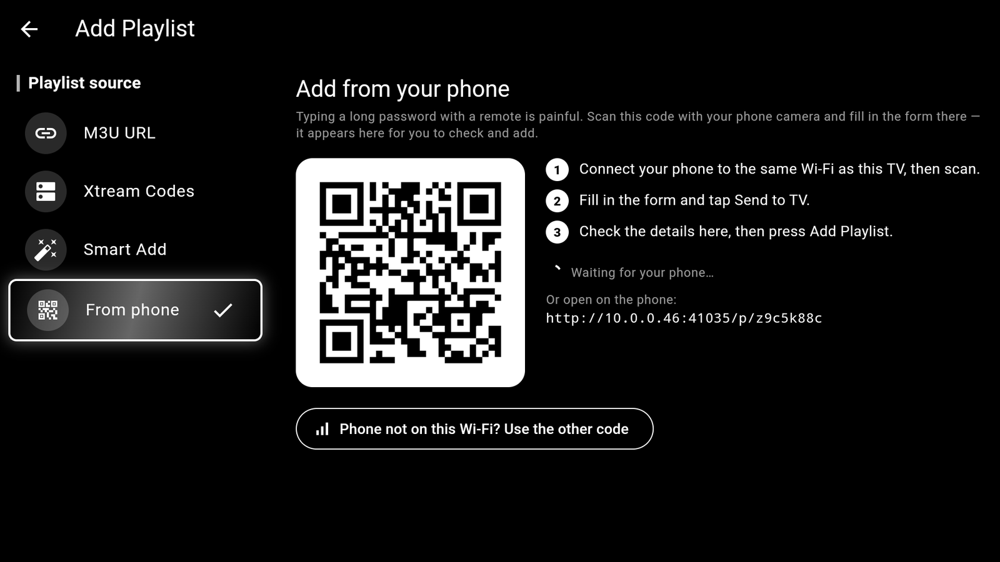
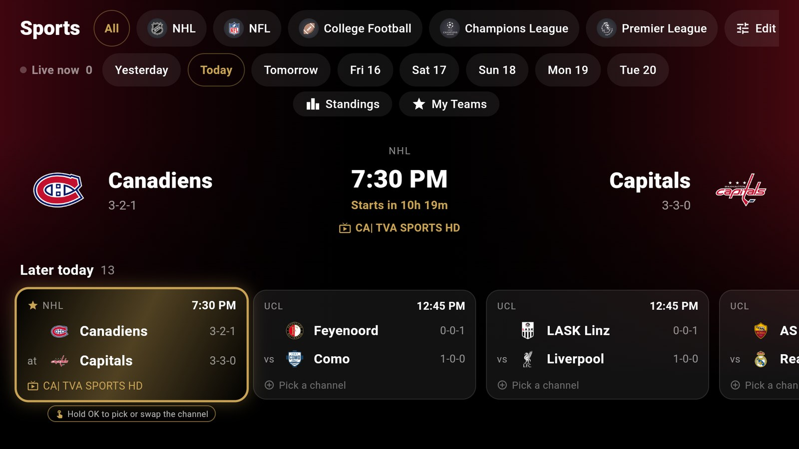
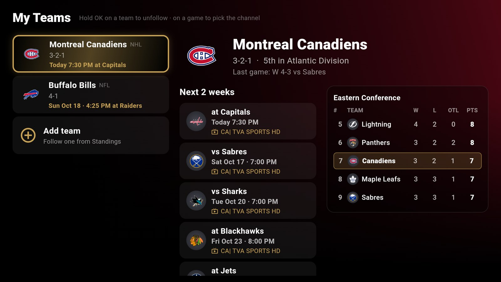
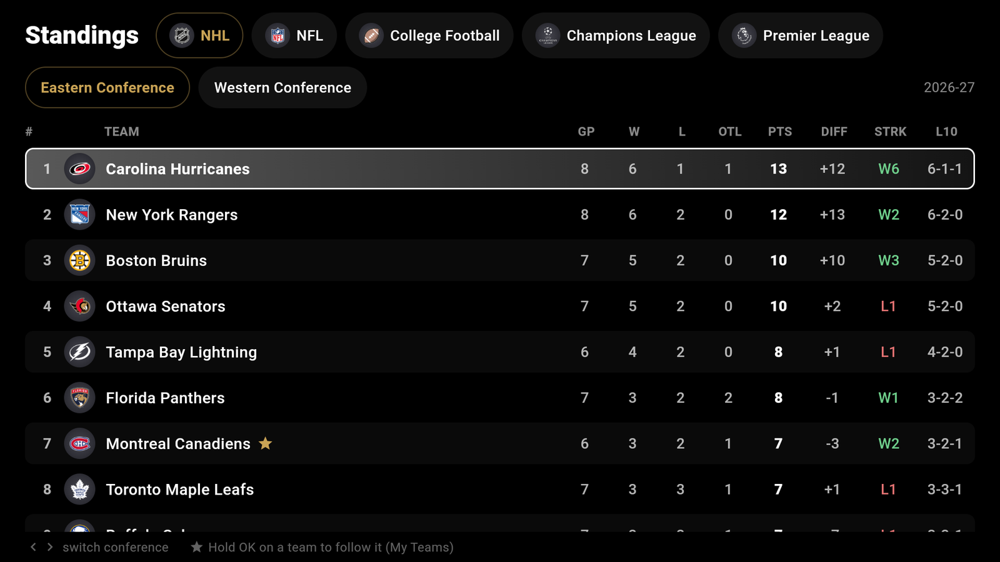
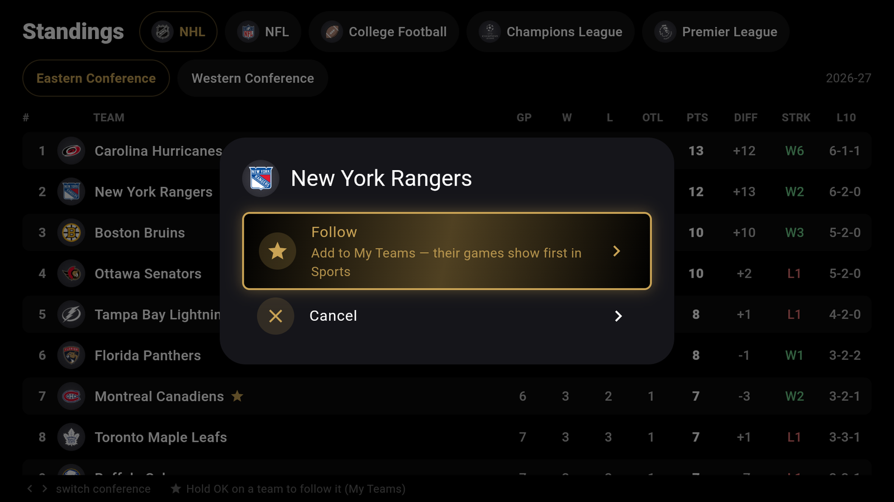
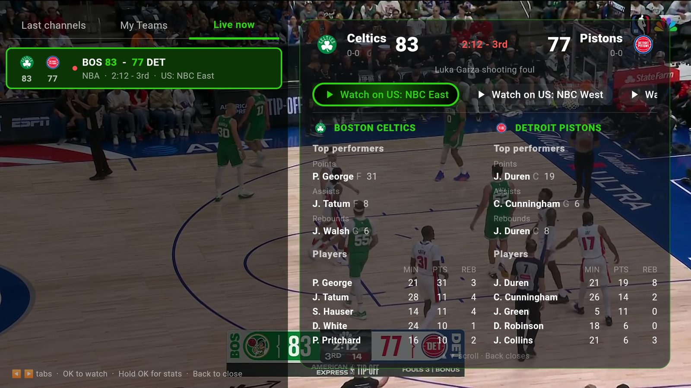

# VesperTV

A free, open-source **universal media player** for Android TV boxes, Fire TV
sticks, phones and Windows 10/11 PCs:

- **Live IPTV** from your own M3U playlist or Xtream Codes (XC API) login, with
  an XMLTV TV guide
- **Custom REST add-ons** in the Media Hub (any source following the
  catalog/stream add-on format)
- **Your own Jellyfin or Emby server** — its movie and TV libraries in the Media Hub

No ads, no tracking, no account. VesperTV ships no content: you bring the sources.
Built and tested on Android TV boxes (Formuler), Fire TV sticks, phones and Windows.

## Download

Grab the latest release from the [Releases](../../releases) page or
[vespertv.app](https://vespertv.app):

- **Android** (phones, Android TV boxes, Fire TV): `app-release.apk`, installed
  directly or side-loaded with [Downloader](https://amzn.to/2GYuEz9) — code **1760256** (or type `vespertv.app/apk`).
- **Windows 10/11 (64-bit)**: `VesperTV-windows-x64.zip` — unzip, then run `VesperTV.exe`.

## Screenshots

  
  
  
  
  
  
  
  

### Sports (new in 1.0.3)

  
  
  
  
  

- **Scores & schedule** for NHL, NFL, NBA, MLB, WNBA, college football, MLS, Premier League,
  Champions League, LaLiga, Bundesliga, Serie A and Ligue 1 — plus a bank of 60+ more leagues
  (college basketball, hockey and soccer, golf, tennis, UFC, F1, NASCAR…) — live scores,
  records, a day strip from yesterday to next week, and a spoiler switch that hides every score.
- **Finds the channel for you:** each game is matched to a channel in *your* playlist (event
  channels, your EPG guide, the broadcasting network). OK on a game starts watching; hold OK to
  pick a different channel and have it remembered for that game or that team.
- **Standings** per conference / league, with streaks, last ten and qualification zones.
- **My Teams:** hold OK on a team in Standings to follow it. Your teams' games get a star and
  come first; My Teams shows each team's record, standing, a mini table and its next two weeks
  of games, one press from the stream.
- No account or API key needed — scores come from ESPN's public data, straight from your device.

## Features

- M3U and Xtream Codes playlist support, with an XMLTV EPG guide
- Live TV, Movies, and TV Shows (series/episodes) catalogs
- **Media Hub**: films and series from REST add-ons you add, and from your own
  Jellyfin / Emby server (sign in with address, user name and password)
- Resume playback position, subtitles, skip/seek controls
- Auto-advance to the next episode with an "Up Next" prompt
- Sports tab: live scores, standings, My Teams, and the matching channel in your playlist
- Multiview: two or four streams at once, with **Live now** (games on right now and
  every channel found for each) and **Sports** shortcuts in the channel picker
- Favorites (channels and groups) and group management (hide/show categories)
- Full remote/D-pad navigation on TV boxes and Firesticks, touch-first layout
  on phones
- Theming with selectable palettes, including a black-and-gold "Dark / Gold" look
- English, French, Spanish and Italian
- Transfer your whole setup to another device (same Wi-Fi or over the internet)

## Setup

On first launch, add your playlist under Settings — either a direct M3U URL
(with an optional separate EPG URL), or Xtream Codes credentials (server,
username, password). Add-ons and Jellyfin / Emby servers are added from the
Media Hub (Settings > Media Hub sources, or **Connect Jellyfin / Emby**).

## Community

Bug reports, suggestions/improvements, or general discussion — join the
[Discord server](https://discord.gg/DDeGDHvFY), or open an issue here on
GitHub. Please also visit us at r/VesperTV

## Credits

- Movie and TV artwork and data may come from [TMDB](https://www.themoviedb.org/). This
  product uses the TMDB API but is not endorsed or certified by TMDB.
- Watch tracking is powered by [Trakt](https://trakt.tv) and [Simkl](https://simkl.com).
  VesperTV is not affiliated with or endorsed by either.
- Sports scores and schedules come from ESPN's public data.

## License and trademarks

The code is free software under the [GPL-3.0](LICENSE). The **VesperTV** name
and logo are trademarks and are **not** covered by the GPL. Forks must use a
different name and icon and run their own pairing/transfer relay instead of
`pair.vespertv.app`. See [TRADEMARKS.md](TRADEMARKS.md).
